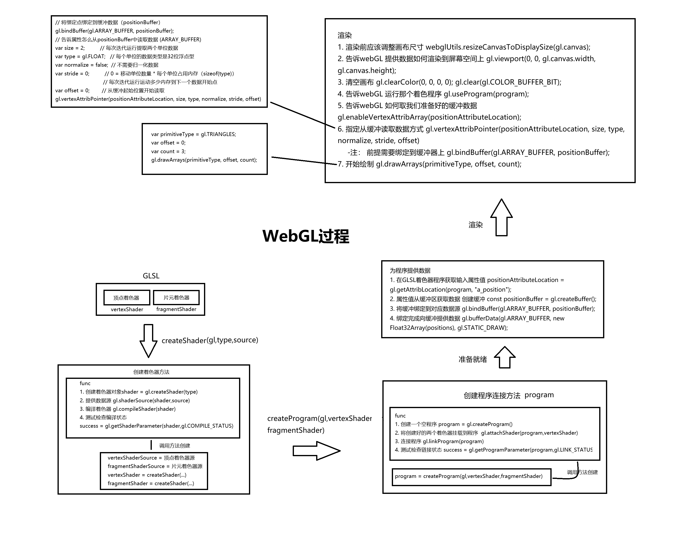

# webGL 基础
接下带带你认识webGL的基础知识。

## 什么是webgl
WebGL仅仅是一个光栅化引擎，它可以根据你的代码绘制出点，线和三角形。
绘制三种类型：
- 点
- 线
- 三角形

WebGL在电脑的GPU中运行。 因此你需要使用能够在GPU上运行的代码。 这样的代码需要提供成对的方法。
每个放大都对应：
- ***顶点着色器*** ———— 作用：计算顶点的位置
- ***片元着色器*** ———— 作用: 计算出当前绘制图元中每个像素的颜色值

并且使用一种和C或C++类似的强类型的语言 ***GLSL***。(GL着色语言)。每一对组合起来称作一个 ***program***（着色程序）。


> 几乎整个WebGL API都是关于如何设置这些成对方法的状态值以及运行它们。

若想绘制每一个对象，都需要先设置一系列状态值，通过调用***gl.drawArrays*** 或 ***gl.drawElements*** 运行一个着色方法对，使得你的着色器对能够在GPU上运行。

这些方法对所需的任何数据都需要发送到GPU，这里有着色器获取数据的4种方法。

- ***属性（Attributes）和缓冲***
> 缓冲是发送到GPU的一些二进制数据序列，通常情况下缓冲数据包括位置，法向量，纹理坐标，顶点颜色值等。 你可以存储任何数据。

- ***全局变量（Uniforms）***
> 全局变量在着色程序运行前赋值，在运行过程中全局有效。

- ***纹理（Textures）***
> 纹理是一个数据序列，可以在着色程序运行中随意读取其中的数据。

- ***可变量（Varyings）***
>可变量是一种顶点着色器给片段着色器传值的方式，依照渲染的图元是点， 线还是三角形，顶点着色器中设置的可变量会在片段着色器运行中获取不同的插值。

## WebGL Hello World

WebGL只关心两件事：裁剪空间中的坐标值和颜色值。使用WebGL只需要给它提供这两个东西。你需要提供两个着色器来做这两件事，一个顶点着色器提供裁剪空间坐标值，一个片段着色器提供颜色值

无论你的画布有多大，裁剪空间的坐标范围永远是 -1 到 1 。




## 着色器源码
可以利用JavaScript中创建字符串的方式创建GLSL字符串
```javascript
// 顶点着色器
<script id="vertex-shader-2d" type="notjs">
 
  // 一个属性变量，将会从缓冲中获取数据
  attribute vec4 a_position;
 
  // 所有着色器都有一个main方法
  void main() {
 
    // gl_Position 是一个顶点着色器主要设置的变量
    gl_Position = a_position
  }
 
</script>
 
// 片元着色器
<script id="fragment-shader-2d" type="notjs">
 
  // 片段着色器没有默认精度，所以我们需要设置一个精度
  // mediump是一个不错的默认值，代表“medium precision”（中等精度）
  precision mediump float;
 
  void main() {
    // gl_FragColor是一个片段着色器主要设置的变量
    gl_FragColor = vec4(1, 0, 0.5, 1) // 返回“瑞迪施紫色”
  }
 
</script>
```
## 创建着色器方法
接下来我们使用的方法将会创建一个着色器，只需要上传GLSL数据，然后编译成着色器。 

```javascript
// 创建着色器方法
function createShader(gl,type,source){
    // 创建着色器对象
    const shader = gl.createShader(type)
    
    // 提供数据源
    gl.shaderSource(shader,source)
    
    // 编译着色器
    gl.compileShader(shader)
    
    // 测试检查编译状态
    const success = gl.getShaderParameter(shader,gl.COMPILE_STATUS)
    if(success){
        return shader
    }
    console.log(gl.getShaderInfoLog(shader));
    gl.deleteShader(shader);
}
```

现在我们可以使用以上方法创建两个着色器

```javascript
const vertexShaderSource = document.getElementById('vertex-shader-2d').text
const fragmentShaderSource = document.getElementById('fragment-shader-2d').text

const vertexShader = createShader(gl,gl.VERTEX_SHADER,vertexShaderSource)
const fragmentShader = createShader(gl,gl.FRAGMENT_SHADER,fragmentShaderSource)


```
## 创建链接着色器程序
然后将这两个着色器链接到着色程序（program）。

```javascript
function createProgram(gl,vertexShader,fragmentShader){
    // 创建一个空程序
    const program = gl.createProgram()
    
    // 将着色器链接到程序
    gl.attachShader(program,vertexShader)
    gl.attachShader(program,fragmentShader)
    
    // 链接到程序
    gl.linkProgram(program)
    
    //检查状态
    const success = gl.getProgramParameter(program,gl.LINK_STATUS)
    if (success) {
        return program;
    }

    console.log(gl.getProgramInfoLog(program));
    gl.deleteProgram(program);
}
```
然后调用它
```javascript
const program = createProgram(gl, vertexShader, fragmentShader);
```
现在我们已经在GPU上创建了一个GLSL着色程序，我们还需要给它提供数据。WebGL的主要任务就是设置好状态并为GLSL着色程序提供数据。 在这个例子中GLSL着色程序的唯一输入是一个属性值 ***a_position***。 我们要做的第一件事就是从刚才创建的GLSL着色程序中找到这个属性值所在的位置。

```javascript
const positionAttributeLocation = gl.getAttribLocation(program, "a_position");
```

属性值从缓冲中获取数据，所以我们创建一个缓冲
```javascript
const positionBuffer = gl.createBuffer();
```
WebGL可以通过绑定点操控全局范围内的许多数据，你可以把绑定点想象成一个WebGL内部的全局变量。 首先绑定一个数据源到绑定点，然后可以引用绑定点指向该数据源。

```javascript
gl.bindBuffer(gl.ARRAY_BUFFER, positionBuffer);
```
现在我们需要通过绑定点向缓冲中存放数据

```javascript
// 三个二维点坐标
const positions = [
  0, 0,
  0, 0.5,
  0.7, 0,
];
gl.bufferData(gl.ARRAY_BUFFER, new Float32Array(positions), gl.STATIC_DRAW);
```

这里完成了一系列事情，第一件事是我们有了一个JavaScript序列 ***positions***

## 渲染
在绘制之前我们应该调整画布（canvas）的尺寸以匹配它的显示尺寸。

为了使画布的像素数和显示大小匹配
```javascript
// https://webglfundamentals.org/webgl/resources/webgl-utils.js
webglUtils.resizeCanvasToDisplaySize(gl.canvas);
```

我们需要告诉WebGL怎样把提供的gl_Position裁剪空间坐标对应到画布像素坐标， 通常我们也把画布像素坐标叫做屏幕空间。为了实现这个目的，我们只需要调用gl.viewport 方法并传递画布的当前尺寸。
```javascript
gl.viewport(0, 0, gl.canvas.width, gl.canvas.height);
```

我们用0, 0, 0, 0清空画布，分别对应 r, g, b, alpha （红，绿，蓝，阿尔法）值， 所以在这个例子中我们让画布变透明了。

```javascript
// 清空画布
gl.clearColor(0, 0, 0, 0);
gl.clear(gl.COLOR_BUFFER_BIT);
```

我们需要告诉WebGL运行哪个着色程序

```javascript
// 告诉它用我们之前写好的着色程序（一个着色器对）
gl.useProgram(program);
```

接下来我们需要告诉WebGL怎么从我们之前准备的缓冲中获取数据给着色器中的属性。首先我们需要启用对应属性
```javascript
gl.enableVertexAttribArray(positionAttributeLocation);
```

然后指定从缓冲中读取数据的方式

```javascript
// 将绑定点绑定到缓冲数据（positionBuffer）
gl.bindBuffer(gl.ARRAY_BUFFER, positionBuffer);
 
// 告诉属性怎么从positionBuffer中读取数据 (ARRAY_BUFFER)
var size = 2;          // 每次迭代运行提取两个单位数据
var type = gl.FLOAT;   // 每个单位的数据类型是32位浮点型
var normalize = false; // 不需要归一化数据
var stride = 0;        // 0 = 移动单位数量 * 每个单位占用内存（sizeof(type)）
                       // 每次迭代运行运动多少内存到下一个数据开始点
var offset = 0;        // 从缓冲起始位置开始读取
gl.vertexAttribPointer(
    positionAttributeLocation, size, type, normalize, stride, offset)
```
一个隐藏信息是gl.vertexAttribPointer是将属性绑定到当前的ARRAY_BUFFER。 换句话说就是属性绑定到了positionBuffer上。这也意味着现在利用绑定点随意将 ARRAY_BUFFER绑定到其它数据上后，该属性依然从positionBuffer上读取数据。

从GLSL的顶点着色器中注意到a_position属性的数据类型是vec4

```glsl
attribute vec4 a_position;
```
vec4是一个有四个浮点数据的数据类型。在JavaScript中你可以把它想象成 a_position = {x: 0, y: 0, z: 0, w: 0}。之前我们设置的size = 2， 属性默认值是0, 0, 0, 1，然后属性将会从缓冲中获取前两个值（ x 和 y ）。 z和w还是默认值 0 和 1 。

我们终于可以让WebGL运行我们的GLSL着色程序了。
```javascript
var primitiveType = gl.TRIANGLES;
var offset = 0;
var count = 3;
gl.drawArrays(primitiveType, offset, count);
```
因为count = 3，所以顶点着色器将运行三次。 第一次运行将会从位置缓冲中读取前两个值赋给属性值a_position.x和a_position.y。 第二次运行a_position.xy将会被赋予后两个值，最后一次运行将被赋予最后两个值。

因为我们设置primitiveType（图元类型）为 gl.TRIANGLES（三角形）， 顶点着色器每运行三次WebGL将会根据三个gl_Position值绘制一个三角形， 不论我们的画布大小是多少，在裁剪空间中每个方向的坐标范围都是 -1 到 1 。

由于我们的顶点着色器仅仅是传递位置缓冲中的值给gl_Position， 所以三角形在裁剪空间中的坐标如下

```text
0, 0,
0, 0.5,
0.7, 0,
```