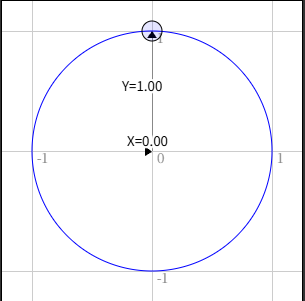

## WebGL 二维平移
...

## WebGL 二维旋转
先看一图:


> 在最上方时 Y 是 1 并且 X 是 0 ，在最右边的时候 X 是 1 并且 Y 是 0 。

如果你还记得三年级的数学知识，数字和 1 相乘结果不变。 例如 123 * 1 = 123 。非常基础，对吧？那么，单位圆，半径为 1.0 的圆也是 1 的一种形式，它是旋转的 1 。所以你可以把一些东西和单位圆相乘， 除了发生一些魔法和旋转之外，某种程度上和乘以 1 相似。

```glsl
uniform vec2 u_rotation;

mian():
  // 旋转位置
  vec2 rotatedPosition = vec2(
     a_position.x * u_rotation.y + a_position.y * u_rotation.x,
     a_position.y * u_rotation.y - a_position.x * u_rotation.x);
 
  // 加上平移
  vec2 position = rotatedPosition + u_translation;
```

```javascript
// 获取定义好的着色器属性值
const rotationLocation = gl.getUniformLocation(program, "u_rotation");

const rotation = [0, 1];

// 设置旋转
gl.uniform2fv(rotationLocation, rotation);
```

旋转公式
    
```javascript
rotatedX = a_position.x * u_rotation.y + a_position.y * u_rotation.x;
rotatedY = a_position.y * u_rotation.y - a_position.x * u_rotation.x;
```

详细讲解前往：[书籍_WebGL 二维旋转](https://webglfundamentals.org/webgl/lessons/zh_cn/webgl-2d-rotation.html)


## WebGL 二维缩放
```glsl
uniform vec2 u_scale;

main():
  // 缩放
  vec2 scaledPosition = a_position * u_scale;
  // 旋转
  vec2 rotatedPosition = vec2(
     scaledPosition.x * u_rotation.y + scaledPosition.y * u_rotation.x,
     scaledPosition.y * u_rotation.y - scaledPosition.x * u_rotation.x);
  // 平移
  vec2 position = rotatedPosition + u_translation;
```

```javascript
//获取着色器属性值
const scaleLocation = gl.getUniformLocation(program, "u_scale");
const scale = [1, 1];

// 设置缩放
gl.uniform2fv(scaleLocation, scale);
```
## WebGL 二维矩阵
[查阅书籍](https://webglfundamentals.org/webgl/lessons/zh_cn/webgl-2d-matrices.html)


