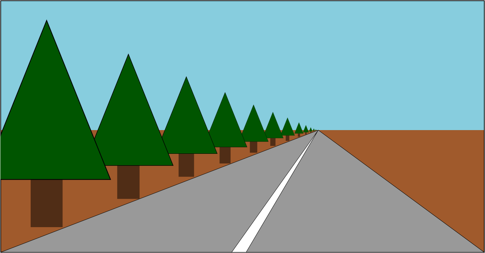

##  WebGL 三维正射投影
[WebGL 三维正射投影](https://webglfundamentals.org/webgl/lessons/zh_cn/webgl-3d-orthographic.html)

## WebGL 三维透视投影
什么是透视投影？ 它的基础特性就是离得越远显得越小。

在上方的示例中，远处的物体会变小，想要实现例子中近大远小的效果， 简单的做法就是将裁减空间中的 X 和 Y 值除以 Z 值。

[前往详细](https://webglfundamentals.org/webgl/lessons/zh_cn/webgl-3d-perspective.html)