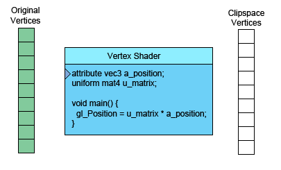

# webGL 工作原理

此文上接[WebGL 基础概念](webgl.md)。 在继续学习之前，我们需要探讨一下WebGL在GPU上究竟做了什么。 WebGL在GPU上的工作基本上分为两部分，第一部分是将顶点（或数据流）转换到裁剪空间坐标， 第二部分是基于第一部分的结果绘制像素点。

当你调用
```javascript
var primitiveType = gl.TRIANGLES;
var offset = 0;
var count = 9;
gl.drawArrays(primitiveType, offset, count);
```
这里的9表示“处理9个顶点”，所以将会有9个顶点被转换。



左侧是你提供的数据。

